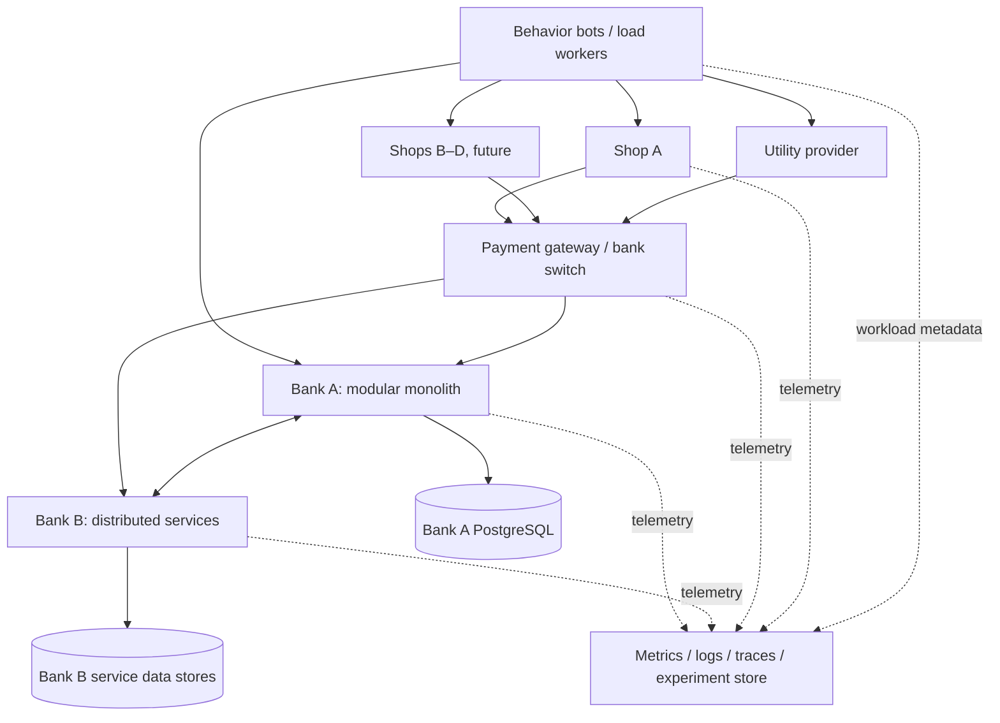

# Target Architecture (working design)

## Bank A modules

`identity`, `customers`, `accounts`, `transfers`, `transactions`, `ledger`, `payments`, `limits`, `risk`, `fees`, `reconciliation`, `notifications`, `audit`.

The module list is a target; some existing modules may have different names or implementation status. Keep domain ownership clear. Transfers/ledger/account updates that must be atomic should share a local database transaction. Avoid cross-module direct table writes where contracts can express the operation.

## Bank B

Independent service deployment and persistence boundaries, with distributed transfer workflows and explicit recovery/reconciliation. Do not assume atomic cross-bank commits.

## Critical flow — shop purchase

1. Customer places order; reserve inventory with expiry.
2. Shop creates payment intent with stable idempotency reference.
3. Gateway routes to the bank with timeout and dedupe semantics.
4. Bank records transaction and balanced ledger postings atomically (within its own datastore).
5. Gateway returns or later resolves payment status, potentially through webhooks.
6. Shop safely handles repeated/out-of-order callbacks; confirms or releases reservation.
7. Reconciliation detects unresolved intents and repairs business state with auditable actions.

## Critical invariant examples

- Sum of debit and credit amounts for each fully posted journal entry is zero under the chosen accounting convention.
- A unique payment/transfer reference cannot cause more than one financial effect.
- A timeout is not evidence of a failed payment.
- Duplicate delivery is supported; consumers are idempotent.
- Unknown or pending states are tracked, not silently considered successful.

## Infrastructure layers

- **Phase 1–3:** Docker Compose and controlled local PostgreSQL / Redis if needed.
- **Later:** Kubernetes service rollouts, network faults and scheduling.
- **Final phase:** Terraform modules and Floci emulator for supported AWS APIs; optional scoped, budgeted real AWS validation.

## Open design decisions

- API contracts for gateway-to-bank and bank-to-bank operations.
- Message transport (e.g. Redis Streams, RabbitMQ, Kafka, SQS emulation) per experiment.
- Service datastore split and cross-bank settlement model.
- Which observability stack to standardize first.
- Scope and topology of AWS emulation based on actual provider coverage.

Document finalized decisions in `docs/DECISIONS`.
